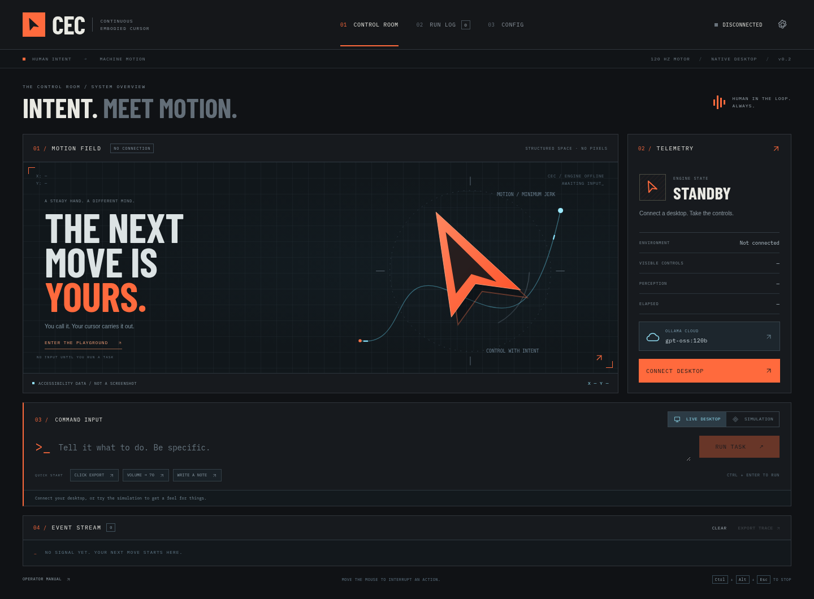
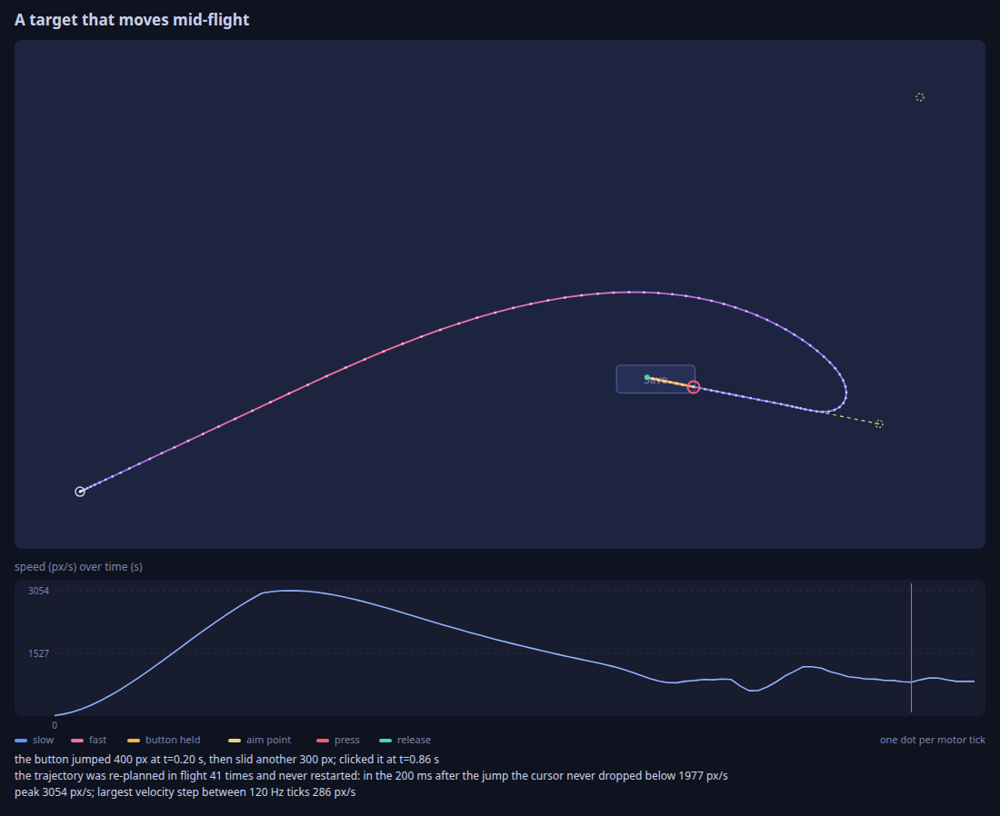
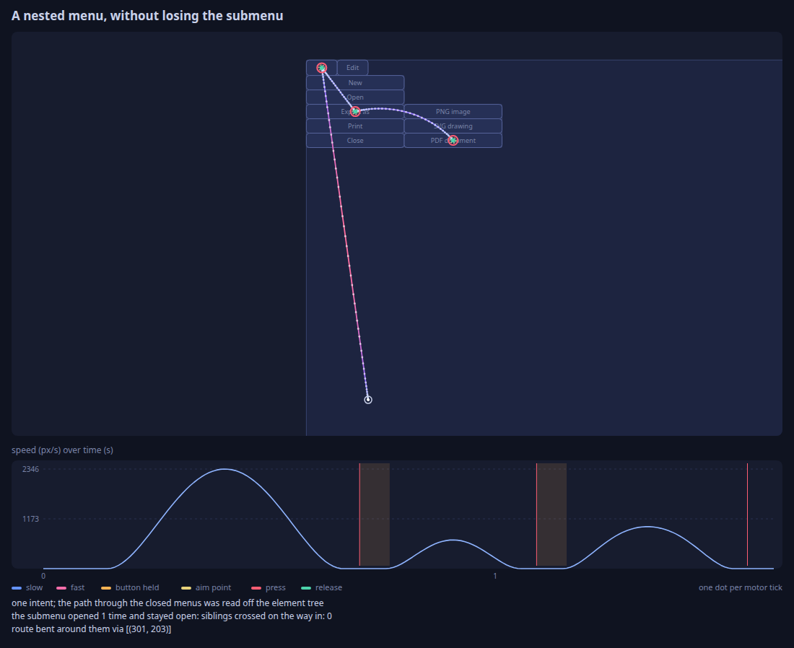

# Continuous Embodied Cursor

It moves your cursor so you don't have to.

The pointer is a small dynamical system. A planner names what should happen — *open File, then Export as PDF; set Volume to 30* — and a fast loop carries it out: minimum-jerk reaches, re-aimed every tick from the accessibility tree, slowed for small targets, bent around menus, and closed on the value a slider actually reports.

Native desktop control is available on **Windows and Linux**. The CLI selects
the backend for the operating system automatically; both use the same motor
controller, planners, intents, trace recording, and human-override detection.

## Platform support

| Environment | Pointer and keyboard | Perception | Daemon transport |
|---|---|---|---|
| Windows 10/11 desktop | Native Win32 input | Windows UI Automation | Windows named pipe |
| Linux X11 desktop | X11/XTEST | Window stack and AT-SPI | Unix socket |
| Simulator | In-process simulated input | Simulated controls | No desktop required |

The simulator runs without a display. **`cec demo` does not move your real
cursor.** Use `cec look` followed by `cec do` or `cec intent` for live control.

## Quick start

Use Python 3.10 or newer. Start from a checkout of this repository:

```text
git clone https://github.com/AaronGrace978/Continuous-Embodied-Cursor.git
cd Continuous-Embodied-Cursor
```

### Windows (PowerShell)

Run these commands with Windows Python on the interactive desktop you want to
control. The `windows` extra installs `comtypes` for UI Automation. Calling the
virtual environment's executables directly avoids PowerShell activation settings.

```powershell
py -m venv .venv
.\.venv\Scripts\python.exe -m pip install -e ".[dev,windows]"
.\.venv\Scripts\cec.exe demo --out traces
.\.venv\Scripts\cec.exe look
```

Open the application you want to control and choose a visible control name from
`look`. For example, if it lists a Save button:

```powershell
.\.venv\Scripts\cec.exe do 'click Save'
.\.venv\Scripts\cec.exe do 'press ctrl+s'
```

### Linux (Bash)

```bash
python3 -m venv .venv
source .venv/bin/activate
python -m pip install -e ".[dev]"
cec demo --out traces
```

Live control requires an X11 display and the X11/XTEST libraries. AT-SPI with
PyGObject supplies application controls; without it, perception falls back to
window rectangles. With an accessible application open:

```bash
cec look
cec do 'open File > Export as > PDF document; set Volume to 30'
```

Choose names that appear in your own `cec look` output. The examples depend on
the application exposing those menus and controls.

## Electron desktop app

**Persistent copilot:** the desktop stays connected between instructions. Use
**Copilot ↗** for a compact command dock, with Stop and recent task context.
Optional **Voice ◉** records commands locally; transcripts can be reviewed or
submitted automatically after an explicit setting change. Voice needs the
`voice` Python extra and a prepared Whisper model. Automatic minimizing is
opt-in. Optional local readers connect the existing
Motion Substrate and ChronoSoul services without putting network calls in the
motor loop. See the [copilot guide](docs/COPILOT.md).

A desktop UI is available in [`ui/`](ui/README.md), with the same Windows and
Linux backends. It includes Ollama Cloud and local Ollama connections, an offline
playground, an animated accessibility map, task history and trace export.



After the Python setup above, install Node.js 22.12+ and run:

```text
cd ui
npm ci
npm start
```

Open **Settings** to add your [Ollama Cloud API key](https://ollama.com/settings/keys),
choose a model and test the connection. Cloud connects directly to `ollama.com`;
no local Ollama server is required. Your goal, recent task outcomes, visible
control text and any enabled substrate readings are sent to the model;
screenshots are not. API keys use OS-backed encryption where
available, with a session-only fallback rather than plaintext persistence.

A floating indicator stays above other windows during live sessions and clearly
separates **Connected · idle**, **Planning**, **Cursor active** and **Stopping**.
Stop from the indicator, the main window, the tray, or **Ctrl+Alt+Esc**. The app
connects and moves the real pointer only when you explicitly choose a live
session and run a task. **Try the playground** exercises the simulator instead.

Hand mouse control now includes **two-finger scrolling** in both axes and a
**three-finger hold to summon an air keyboard**. In typing mode, either hand's
fingertips select keys by their calibrated camera position; deliberate finger
bends press them without steering and clicking the mouse. The floating keyboard
shows fingertip feedback and preserves the target application's focus. It
includes calibration, Shift/Caps, symbols, editing, and navigation. Camera
recognition accuracy still needs hardware trials; see the
[hand scrolling and air typing guide](docs/HAND_CONTROL.md).

See the [desktop app guide](ui/README.md) for controls, credentials, tests,
Python runtime selection and Windows/Linux packaging. Packaged apps include the
Python source but require a Python installation; Windows also needs `comtypes`.

The desktop app runs supported explicit commands locally by default, reserving
Ollama for open-ended goals. Choose **Careful**, **Responsive** (default), or
**Fast** in Settings. You can add tasks while it works; queued goals run in order
and pause on failure, interruption, or Stop. Longer goals can continue through
24 planning rounds and 160 actions, with a guard against repeating the same failure.

**Enable camera** starts a mirrored webcam preview and on-device MediaPipe hand
tracking. Open your hand to arm, move your index finger to steer, and pinch your
thumb and index finger to click. The camera is off on launch. Video is never sent
to Ollama or Python; the cursor engine receives only fingertip coordinates and
pinch distance. See the guide for the model download, controls and limitations.

## Native Windows backend

The Windows backend adds:

- **Real pointer movement and readback:** `SetCursorPos` and `GetCursorPos` drive
  the system pointer and feed its actual position back into the controller.
- **Mouse and keyboard input:** `SendInput` handles left, middle and right
  buttons, dragging, vertical and horizontal wheel input, key chords, navigation
  and function keys, and UTF-16 text including emoji.
- **Structured perception:** UI Automation reads control names, roles,
  hierarchy, live bounds, focus, visibility, enabled state, selection, checkboxes,
  expanded controls, editable text and range values when the application exposes
  the corresponding properties and patterns.
- **Desktop geometry:** monitor enumeration, per-monitor DPI awareness and
  negative coordinates support desktops spanning multiple monitors.
- **Persistent sessions:** the daemon uses a named pipe, while spatial memory
  is saved under `%LOCALAPPDATA%\embodied-cursor\memory.json`.

UI Automation runs on the perception thread with its own COM initialization
and cleanup. Full snapshots are traversed incrementally; attended controls are
refreshed separately for the shared motor loop. Linux retains its X11/XTEST
and AT-SPI backends.

Use Windows Python for this backend. WSL selects the Linux backend and requires
an X11 display. An interactive Windows desktop is required; Windows services and
secure desktops such as UAC prompts are not supported. Windows can block input
into elevated applications from a normal process (UIPI), so run the controller
and target at the same integrity level. `--display` is an X11-only option.

## Two speeds

The planner thinks in goals. The body moves in real time.

| | Planner | Body |
|---|---|---|
| When | At a decision: the start, a failure, a surprise dialog, the end of a plan | Every tick, 120 Hz |
| Input | A short text listing of the windows and controls | The world model, refreshed at 60 Hz around the pointer |
| Output | Intents: click, scrub, type, drag, key, scroll, wait | A continuous position, velocity and acceleration |

Between those decisions the planner is not in the loop. A button that jumps, a popup that covers the target, a slider whose response is curved: the body answers on the next tick.



The button above jumps 400 px and then slides. The reach is re-planned 41 times from the cursor's current position, velocity and acceleration. In the 200 ms after the jump the speed stays above 1977 px/s; the path bends, it does not restart. Peak speed on this run is 3054 px/s, and the largest velocity change between two 120 Hz ticks is 286 px/s.



One intent, `open File > Export as > PDF document`. The path through the closed menus is read off the element tree. The route passes through a via-point so the pointer never crosses Print or Close, and the submenu stays open.

## Commands

```
cec demo [scenario] [--out DIR]          moving-target, popup, nested-menu, scrub
cec look [--json]                        the screen as the planner sees it
cec find 'slider "Volume"'               elements matching a selector
cec do 'click Export; set Volume to 70'  plain commands, planned offline
cec run 'export this as a PDF'           open-ended goal, planned by a language model
cec intent '{"action":"click","target":"button \"Export\""}'
cec daemon                               keep perception warm; serve a socket or named pipe
cec send '{"op":"status"}'
cec render trace.json -o trace.svg
```

`cec do` understands clauses separated by semicolons: click, double-click, right-click, hover, move to, press a key chord or a button, set/slide a control to a number or a percent, drag onto, scroll, wait for, check, uncheck, type, and `fill Search with "embodied cursor" and press enter`.

`cec run` talks to an OpenAI-compatible server. Point it wherever the model is:

```bash
export CEC_LLM_BASE_URL=http://127.0.0.1:8080/v1
export CEC_LLM_API_KEY=...          # optional; OPENAI_API_KEY is also read
export CEC_LLM_MODEL=...
```

In PowerShell, set the same variables using `$env:`:

```powershell
$env:CEC_LLM_BASE_URL = 'http://127.0.0.1:8080/v1'
$env:CEC_LLM_MODEL = 'your-model-name'
# Set CEC_LLM_API_KEY or OPENAI_API_KEY if your server requires authentication.
.\.venv\Scripts\cec.exe run 'export this as a PDF'
```

The model is shown the same text listing as `cec look` and answers with intents as JSON. It is asked for element names, and the controller finds them.

### Daemon and persistence

`cec daemon` keeps perception running between requests. One request moves the
pointer at a time; other requests wait their turn. Status, observation, intent,
goal, cancellation, event streaming and shutdown operations use the same request
vocabulary on both platforms.

| Platform | Default endpoint | Encoding | Spatial memory |
|---|---|---|---|
| Linux | `$XDG_RUNTIME_DIR/embodied-cursor.sock`, or `/tmp/embodied-cursor-<uid>/embodied-cursor.sock` | Newline-delimited UTF-8 JSON; socket mode `0600` | `$XDG_STATE_HOME/embodied-cursor/memory.json`, or `~/.local/state/embodied-cursor/memory.json` |
| Windows | `\\.\pipe\embodied-cursor-<user-hash>` | UTF-8 JSON byte messages; Windows default pipe DACL | `%LOCALAPPDATA%\embodied-cursor\memory.json` |

`--socket` overrides the endpoint for both `daemon` and `send`. On Windows, use
a full pipe name such as `\\.\pipe\your-name`. `--no-memory` disables reading and
writing spatial memory for a live session.

For Windows, start the daemon in one PowerShell window:

```powershell
.\.venv\Scripts\cec.exe daemon
```

Then query it from another window in the repository. The Python client avoids
differences in JSON argument quoting between PowerShell versions:

```powershell
.\.venv\Scripts\python.exe -c "from embodied_cursor.daemon import request; print(request({'op': 'status'}))"
```

While a skill is running, a person moving the mouse aborts it. The outcome is `human_override`, and the click is not delivered.

## Layout

```
src/embodied_cursor/
  motor/        minimum-jerk plans, Fitts timing, hover-safe routing
  world/        elements, selectors, the world model, foveated perception, spatial memory
  skills.py     reach, click, drag, scrub, type, scroll: generators stepped every tick
  body.py       the 120 Hz loop
  brain/        text observation, the planner protocol, heuristic and LLM planners, the agent
  backends/     simulator, Linux X11/XTEST + AT-SPI, Windows Win32 + UI Automation
  cli.py        cec
  daemon.py     the local daemon and platform-specific transport
  render.py     an SVG of a recorded trace
examples/playground_gtk.py
```

The design of each piece is in [docs/ARCHITECTURE.md](docs/ARCHITECTURE.md).

## Tests

The suite without desktop tests exercises the simulator, controller, planners,
Windows input event construction and ABI layout, and the native daemon transport
for the current operating system. No display is required:

```bash
python -m pytest -q -m "not desktop"
```

Use the virtual environment's Python; on Windows the equivalent is
`.\.venv\Scripts\python.exe -m pytest -q -m "not desktop"`.

**Live desktop tests move the real pointer.** Leave the mouse alone while they
run. Run the tests for your operating system:

| Platform | Command | What it checks |
|---|---|---|
| Windows | `.\.venv\Scripts\python.exe -m pytest -q tests/test_windows_desktop.py` | Creates native Win32 controls and checks UI Automation discovery, pointer movement, checkbox clicking and Unicode text entry. |
| Linux | `python -m pytest -q tests/test_live_desktop.py` | Launches `examples/playground_gtk.py` and checks real X11/XTEST input with GTK 3 and AT-SPI. |

The portable tests do not establish that native desktop control works on a
particular machine. Desktop tests require that platform's interactive session
and dependencies; tests for other platforms are skipped.

[GitHub Actions](.github/workflows/tests.yml) is configured to run the suite
without desktop tests and all four simulation demos on Ubuntu and Windows with
Python 3.10 and 3.12, plus the native Windows desktop smoke test on Windows runners.

## Limits

These are the edges of what this tree does today.

- The Linux live backend requires an X11 display. A Wayland session works only through XWayland, and the pointer moved is the X pointer. Windows uses its native Win32/UI Automation backend. macOS is not implemented.
- The Linux actuator is XTEST: motion, buttons, keys and the wheel. That protocol has no pressure axis, and this program does not open `/dev/uinput`.
- The controller is arithmetic in this process. It does not need a GPU. A language model, if you configure one, is a separate HTTP server. The tests of that path use a local stub; no model is shipped or called from here.
- Perception reads the window stack and AT-SPI on Linux, and UI Automation on Windows. Controls must be exposed through the platform's accessibility API. On Linux, an application without an accessible tree falls back to a titled window rectangle. Chromium can expose its page to accessibility tools when started with `--force-renderer-accessibility`. There is no screenshot fallback or Chrome DevTools client.
- A target that leaves in the instant the button goes down is reported as `target_moved_away`. The planner can retry. The press itself cannot be taken back.
- Scrubbing a control servos on the value the control reports. In the simulator, sixteen controls (linear, reversed, quadratic, cubic, square-root, and integer steps) at perception delays of 0, 30, 60 and 120 ms all finished on the requested value, and none ran more than one unit past it. On the GTK playground here, the volume slider landed on 73 and on 12 with the same bound. The drag stops short and then homes on readings taken at rest, so it takes a few seconds. If the final reading is still wrong, the outcome is `value_mismatch` rather than a false success.

## License

GNU Affero General Public License v3.0 or later. It is the GPL with one further term: anyone who runs a modified copy as a network service must offer its source to the people using it. See [LICENSE](LICENSE).
