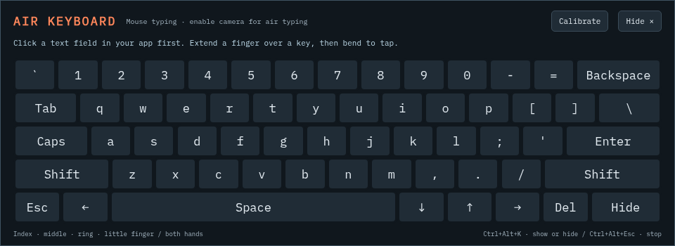

# Continuous Cursor · Electron

A motion-control console for the existing Python motor and perception backends.
Graphite surfaces, orange action cues, a cursor field and a command deck.
Windows uses Win32/UI Automation; Linux uses X11/AT-SPI. No web server is exposed:
the isolated renderer talks to Electron, which owns a Python process over stdio.

## Run from source

Install Node.js **22.12 or newer** (Node 24 recommended) and Python **3.10 or newer**.
From the repository root, set up Python using the main README. On Windows:

```powershell
py -m venv .venv
.\.venv\Scripts\python.exe -m pip install -e ".[dev,windows]"
cd ui
npm ci
npm start
```

On Linux, prepare `.venv` with `python3 -m venv .venv` and
`.venv/bin/python -m pip install -e '.[dev]'`, then run the same npm commands in
`ui`. Live Linux control requires an X11 desktop and its native dependencies.
The app does not connect to a desktop or move the pointer on launch.

The app finds the repository's virtual environment first, then system Python.
To use another interpreter, set **Settings → Runtime → Python executable**, or
set `CEC_PYTHON` before launching. Supply an executable path, not a shell command.

## Ollama Cloud

1. Open **Settings** and select **Ollama Cloud**.
2. Create a key at <https://ollama.com/settings/keys> and enter it in the app.
   Alternatively, supply `OLLAMA_API_KEY` in the app's environment.
3. Load the model list or enter a model name directly. The default is
   `gpt-oss:120b`; use an exact name available to your account. Cloud API names
   can differ from local `-cloud` model aliases.
4. Choose **Test connection**. This sends a small prompt using your selected
   model and verifies authenticated generation. Loading the public model catalog
   alone does not verify a key or model access.
5. Save settings, connect **Live desktop**, enter a goal, and choose **Run task**.

The native Ollama endpoints are `https://ollama.com/api/tags` and
`https://ollama.com/api/chat`. A local Ollama installation is unnecessary for
Cloud. The planner receives your goal, visible accessibility control text,
recent tasks and action outcomes, and any enabled substrate readings. It receives
no screenshots. Requests can consume your
Ollama Cloud allowance.

Keys are encrypted with Electron's OS-backed `safeStorage` when secure storage
is available. If Linux offers only the `basic_text` fallback, the key stays in
memory for that session and is not persisted. Environment keys are not written
to settings. Saved keys are never returned through the renderer API; the settings
form receives only whether a key is configured. The API key is sent only to the
Cloud endpoint, and redirects are rejected.

**Local Ollama** supports a loopback endpoint such as `http://127.0.0.1:11434`.
Cloud credentials are not sent to the local endpoint. **Offline commands** uses
the existing heuristic planner and makes no model requests.

## Persistent copilot

After connecting, choose **Copilot ↗** for the floating command dock. It stays
available between tasks and reports what the engine is doing or waiting for.
Follow-up instructions share bounded session context; **New context** clears it
without disconnecting. Automatic minimizing is opt-in, including after the
one-time settings migration. The optional Motion Substrate and ChronoSoul
connections read cached state from their separately running local services.
See the [copilot guide](../docs/COPILOT.md) for setup and current limits.

## Local voice

Install `.[voice,windows]` into the selected Python runtime, then choose
**Settings → Local voice → Prepare local voice** to download the English model.
**Voice ◉** starts a recording; choose Finish to transcribe locally and review
its text in the command box. Execution after transcription is an explicit
setting. Audio is never saved or uploaded. Stop cancels recording and decoding.
See the [voice setup and limits](../docs/COPILOT.md#local-voice-commands).

## Responsiveness and autonomous goals

**Run explicit commands locally** is enabled by default. Commands understood by
the offline grammar, such as `click Export` or `fill Notes with hello`, bypass
the provider entirely, even when Ollama Cloud is selected and no key is saved.
Other goals use the configured provider. Disable this setting when you want
the model to interpret every instruction, including commands beginning with
`click`, `open` or `type`.

Settings offers three movement speeds. Careful uses a 1.15 movement duration
multiplier and 60 characters/second; Responsive uses 0.8 and 240; Fast uses 0.6
and 720. Speed caps, small-target timing, live target tracking, slider feedback,
and mouse override still apply. Inter-action pauses can end when a fresh full
observation confirms a visible effect. Focus/press echoes alone do not shorten
the pause, so delayed dialogs still have time to appear.

An open-ended goal can continue for up to 24 planning rounds or 160 actions,
within a ten-minute request limit. Three consecutive identical failed actions
stop the goal instead of repeating indefinitely. The companion's gaze, blinking,
and messages reflect input and the actual planning/moving state. Reduced-motion
preferences disable its animations.

While a goal runs, enter another and choose **Queue task** (up to 20 waiting
goals). They execute in order without another Run click. Stop, a failed goal,
mouse interruption, disconnect, and enabling hand control pause the queue;
choose **Resume queue** when ready. Individual waiting tasks can be removed, or
the queue cleared. Queue and history stay in memory for this app session.

## Camera and hand control

Connect a desktop or the simulation, then choose **Enable camera**. Camera
access is requested only at that point, with no microphone access. Voice microphone permission is separate and scoped
to an explicitly started voice recording. The first
enable in an app session downloads Google's hand-landmarker model from
`storage.googleapis.com`; internet access to that host is required. The pinned
MediaPipe JavaScript/WASM runtime is copied locally by `npm ci` and included in
packaged apps. No remote JavaScript is loaded. If install scripts were skipped,
run `npm run postinstall` before starting or packaging.

The mirrored preview marks the fingertip and pinch distance. Keep one hand
clearly visible in good light:

- Hold your thumb and index finger apart for a quarter-second to arm.
- Move your index finger to steer. The central 80% of the image maps to the
  monitor containing the pointer when hand control starts, including monitors
  with negative coordinates. Only that monitor is controlled during the session.
- Pinch thumb and index finger for at least 60 ms to left-click. The pointer
  stays still during the pinch; holding it produces one click. Open again to
  permit another click. There is no hand-drag gesture yet.
- Raise index and middle fingers, curl ring/little fingers, and hold for
  180 ms to scroll. Move away from the starting point to control wheel speed;
  return to neutral to stop. Both axes work, with a dead zone and a maximum
  of ten notches/second per axis. The pointer stays over the scroll target.
- Hold index/middle/ring up with the little finger curled for 800 ms to summon
  the **air keyboard**. **Air keyboard** and **Ctrl+Alt+K** are alternatives.
- With the keyboard open, position either hand's index/middle/ring/little
  fingertips over the displayed keys, then bend individual fingers to tap.
  The system selects each key from the fingertip's settled position before the
  bend. It supports both hands, independent release latches, Shift/Caps,
  punctuation, space, editing/navigation, and an air-tappable **Hide** key.
- Choose **Calibrate** and pinch at upper-left, release, then pinch at lower-right
  to set your typing rectangle. The preview and floating keyboard share a grid
  and show fingertip locations. The target app keeps keyboard focus.
- Tracking loss or a frame gap over 250 ms disarms clicks. Show an open hand
  again to resume. Moving the physical mouse ends hand control.
- **Disable camera**, **Stop**, **Escape**, the global shortcut, disconnect,
  or quitting releases the webcam. Tasks and hand control cannot run together.

Frames are processed on-device in the isolated renderer. Only normalized
fingertip coordinates, a palm-relative pinch distance, a gesture label, and
individual keyboard actions cross the Python IPC bridge, never images or video. No camera recording is saved. The model is reused
until the app exits; the camera itself is released every time hand control ends.
Permission, missing-camera, model-download, and tracking errors leave normal
task execution available. The preview and controller can be tried in simulation
before enabling live pointer input.

Automated tests cover gesture state, smoothing, hysteresis, invalid input,
camera permission failures, release during pending startup, independent finger
taps, calibration, scroll/keyboard latches, exclusive engine ownership and cancellation. Browser tests stub hardware/model inference; real
webcam inference and native Windows hand input still need a hardware trial.

Air typing uses a calibrated visible surface and deliberate finger bends; it
cannot recover arbitrary invisible physical-keyboard typing. Recognition and
sustained speed depend on camera angle, lighting, and occlusion. Hardware accuracy
has not been benchmarked. See the [hand control guide](../docs/HAND_CONTROL.md)
for setup, gestures, timing, calibration, and recovery.



## Activity and stop controls

- **Connected · idle:** perception is connected, with no active task.
- **Planning:** a planner is choosing the next actions.
- **Cursor active:** the body is executing an intent. A wait or unresolved target
  can keep this state visible even when the pointer is momentarily stationary.
- **Stopping:** cancellation is in progress.

While a live desktop is connected, an always-on-top strip shows the current
state and a **Stop** button, even when the main app is minimized. The app also
updates its tray icon, window title, and Windows taskbar overlay. The strip can
be disabled in Settings; it is hidden for simulation sessions.

Stop from the strip, the main window, the tray menu, or **Ctrl+Alt+Esc**. The
shortcut's availability is reported in the main window if registration fails.
Moving the physical mouse interrupts an executing action through the existing
human-override detector. During model planning, use Stop or the shortcut.

Cancellation is checked by the motor loop. A blocked model request that does
not unwind within 1.5 seconds causes the app's owned backend process to stop;
the late model reply cannot execute. Reconnect afterward. Closing the app ends
its own backend session; an unrelated `cec daemon` is not stopped or reused.

The app refreshes perception before a live task. Move the control room aside
or use the compact dock to uncover your target. Minimizing on each task is an
optional setting and is off by default.

## Playground and traces

**Try the playground** connects a deterministic simulated desktop and selects
offline commands. Try `click Export`, `set Volume to 70`, or
`fill Notes with hello world`. No system input or model connection is needed.

The desktop map is a schematic of actual accessibility bounds, not a screenshot.
Session history and the activity feed stay in memory; no chat transcript is saved.
**Export trace** opens a save dialog for a JSON motor trace, scene and last report.

## Tests

```bash
npm test
npm run test:e2e
npm run test:electron
```

The Node tests exercise settings persistence, key handling and the real Python
stdio protocol. Browser tests drive the production renderer with the real Python
simulation and an HTTP Ollama stub. The Electron smoke test launches the actual
sandboxed app, checks preload/IPC, executes a simulated task and cancels another.
The default tests use no paid Cloud account and do not move the system pointer.
An additional `CEC_TEST_LIVE_INDICATOR=1` smoke check connects the live desktop,
verifies the always-on-top strip, types into a separate app through native input
while checking keyboard focus, and cancels an unresolved target from that strip.
Run that opt-in check in an isolated desktop session.

Browser tests use `CHROMIUM_PATH` if supplied, the system Chromium on Linux when
present, or Playwright's browser (`npx playwright install chromium`). Native
Electron tests need a graphical session. On a headless Linux CI runner:

```bash
xvfb-run -a npm run test:electron
```

Restricted containers may require `CEC_ELECTRON_TEST_ARGS='--no-sandbox --disable-gpu'`
for the test runner. These switches are not part of the application's startup
configuration. `CEC_USER_DATA_DIR` can isolate test or portable app settings.
Live Win32/UIA and X11 integration tests remain in the Python test suite.

## Packaging

```bash
npm run package
npm run dist
# On Linux, validate the actual packaged AppImage:
npm run test:appimage
```

`package` creates an unpacked app; `dist` creates a Windows NSIS installer or
Linux AppImage on the corresponding build host. Electron Builder includes the
Python source in app resources. **Python itself is not bundled**: the installed
app still needs Python 3.10+ and, on Windows, `comtypes`. Use the interpreter from
the Python setup above or install `comtypes` into your chosen interpreter.

Build Windows installers on Windows and Linux AppImages on Linux. The CI desktop
workflow builds an installer/AppImage as an Actions artifact, without publishing
a GitHub release. A code-signing identity is not configured.
